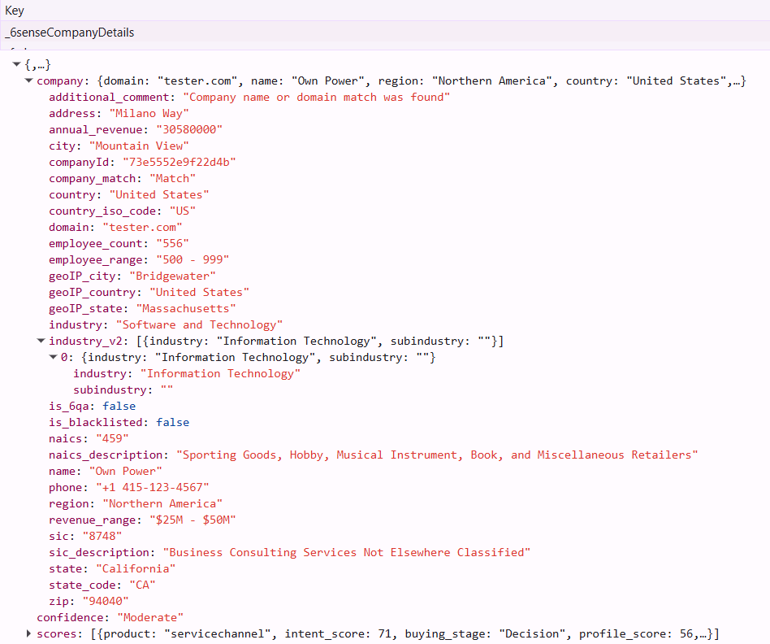
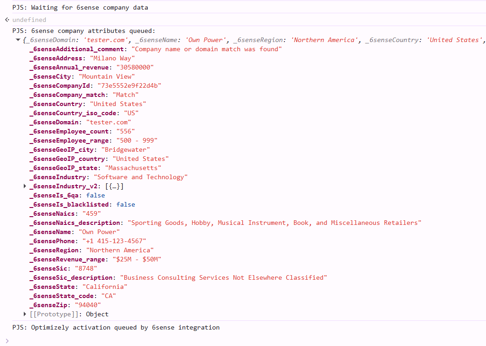

##  

### 6Sense Integration

Use [6Sense Integration.js](./6Sense%20Integration.js) in Optimizely Web Experimentation Project JavaScript to make 6sense company data available for audience targeting.

  

### Setup and behavior

1. In Optimizely, create the custom attributes you want to use for audience targeting. The script does not create them for you. Each attribute name starts with `_6sense`, followed by the company field name with its first letter capitalized (for example, `domain` becomes `_6senseDomain` and `country_iso_code` becomes `_6senseCountry_iso_code`).
2. Add the integration script to Project JavaScript. It checks `window._storagePopulated` every 50 ms for up to about five seconds. When the flag is set, it parses `localStorage._6senseCompanyDetails` and reads `company` directly. Only `company` fields are mapped to attributes in the `user` event, followed by `activate`. Other top-level fields, such as `scores`, `segments`, and `confidence`, are ignored after parsing. If the poll times out, it stops without queuing activation.

### Debug logging

Set `_6senseDebug` near the top of the script to `true` to log polling, timeouts, queued attribute names, and queued activation in the browser console. Set it to `false` to disable these messages. Attribute values are not logged.

To test, copy the code into your browser dev tools console and press enter.

#### Console log output

  

